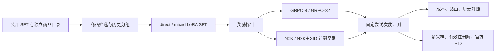

# MiniOneReason

基于 **OneReason-0.8B** 的生成式推荐后训练项目：从多域行为历史生成商品 SID，研究 **稀疏奖励怎样变成训练信号，以及推理成本能换来多少推荐收益**。

项目包含数据适配、direct / mixed LoRA SFT、四种 RL 对照、思考预算与路由、历史选择实验，以及官方商品任务评测。文档和结果更新至 **2026-10-24**，已纳入有效性分解、五次非思考采样和官方 mixed-SFT 基线。

## 从这里阅读

| 文档 | 内容 |
| --- | --- |
| [项目故事](docs/项目故事-MiniOneReason.md) | 按问题、决策和实验串起研究过程；六个代码入口、关键机制走读与面试口述稿 |
| [项目深挖](docs/项目深挖-MiniOneReason.md) | 40 道分级问答，覆盖数据、SFT、GRPO、分支信用、成本与结果追问 |
| [实验结果与来源](docs/实验结果与来源.md) | 数据规模、主要数字、比较口径、置信区间和源码入口 |
| [主实验报告](reports/PROJECT_REPORT.md) | seed 42 主队列、预算路由、历史实验与外部评测 |
| [补充评测报告](reports/checks/CHECKS_REPORT.md) | M1 有效性分解、M2 多采样、M3 官方基线对照 |

## 主要结果

| 对照 | 基线 → RL 前缀模型 | 差值与解释 |
| --- | --- | --- |
| 本地 thinking Recall@32 | mixed SFT **2.233% → 4.467%** | +2.233 pp，分组配对 95% CI [0.478, 4.082] |
| 固定权重、五次 non-thinking 采样的平均 Recall@32 | **1.836% → 3.474%** | +1.638 pp，95% CI [0.500, 3.027]，五次差值均为正 |
| 同上，平均目录有效率 | **61.163% → 70.125%** | 目录外 SID 减少；等 16 个有效尝试后的差值区间跨零 |
| 官方 1,000 条商品任务，PID Recall@64 | **1.816% → 2.002%** | +0.186 pp，95% CI [−0.275, 0.672] |

本地 test 为 403 条、314 个输入组，训练 seed 为 42；五次采样复用同一组权重。主模型对照固定 64 次尝试，Recall@32 取原始前 32 次。官方任务使用多目标标签、Race 32＋32 和独立 SID/PID 评分。完整定义见[结果口径](docs/实验结果与来源.md)。

两项成本结论同样保留：RL 模型在 512 与 1024 思考预算下的 Recall@32 均为 3.722%，512 档生成 token 约少 32.93%；自适应路由未超过同源的全非思考对照。见[成本与路由分析](docs/实验结果与来源.md#6-推理成本路由与历史)。

## 方法与流程



- **数据**：48,269 条公开记录中筛出 3,988 条商品答案；过滤后 train / validation / test 为 2,647 / 385 / 403，按规范化历史分组。商品目录来自独立 Pid2Sid 表，包含 10,295,563 个不同 SID。
- **SFT**：每条样本展开两次；direct 两次直接答案，mixed 各一次直接答案和推理答案。LoRA r=16，约 1,009 万个可训练参数；另设处理 token 匹配对照。
- **RL**：共同的 500 个训练输入顺序；N×K=4×8，共享推理取子答案优势均值。合法 SID 的完整命中、前两级命中、一级命中奖励分别为 1 / 0.5 / 0.2。
- **评测**：无效和重复答案都占尝试次数；记录生成 token、目录有效率与覆盖，使用配对 bootstrap。预算与路由的模型选择、阈值先在验证集确定。

## 代码结构

```text
minionereason/
├── data.py             # 解析、标签边界、分组划分、目录与快照下载
├── history.py          # 完整事件的 token 预算选择
├── model.py            # LoRA 加载、Transformers / vLLM、两阶段生成
├── train.py            # SFT、GRPO、N×K 采样与信用分配
├── evaluate.py         # 固定尝试评分、bootstrap、成本与路由
├── baselines.py        # 热门与 SASRec 参考
├── run.py              # 命令入口与 43 项主队列
├── config.json         # 冻结的训练与采样配置
├── env.sh              # 数据根目录、缓存和运行环境
├── tests/              # 数据、训练信用、缓存与统计逻辑检查
├── ops/                # 结果汇总、补充评测、官方批次恢复
├── docs/               # 故事、40 题深挖、数字来源
├── artifacts/          # 固定资源版本、实验协议与选择记录
└── reports/            # 实测汇总、图表、主报告与补充分析
```

## 运行环境

训练与生成使用 **Linux、NVIDIA GPU、Python 3.11**。实测训练环境使用 PyTorch 2.8.0、Transformers 4.57.1、PEFT 0.17.1、TRL 0.24.0、vLLM 0.11.0；主要包版本见 [requirements.txt](requirements.txt)，完整实验环境见 [environment.lock.txt](reports/environment.lock.txt)。

主训练与模型对照使用共享 RTX 4090，后续成本、历史和补充评测使用 RTX 5090。完整商品目录、数据集、模型与预测需要额外存储；它们由 `MINIONEREASON_DATA_ROOT` 管理。

### 只检查本地逻辑

以下检查不下载权重或数据，不启动训练；适用于 Python 3.11+：

```bash
python -m pip install "numpy>=1.26,<3"
python -m unittest discover -s tests -v
python run.py --help
```

公开仓库包含 20 项测试。冻结参考模型的数值测试需要 torch 与 PEFT，在缺少这些依赖时跳过；其余检查覆盖 SID 解析、标签隔离、固定尝试预算、分支优势、缓存、统计逻辑与报告打包。GPU 训练与生成需在下面的实验环境运行。

### 在新工作目录准备数据与模型

```bash
git clone https://github.com/prossiblezero/minionereseaon.git minionereason
cd minionereason

export MINIONEREASON_DATA_ROOT="$PWD/.runtime"
export CUDA_VISIBLE_DEVICES=0
mkdir -p "$MINIONEREASON_DATA_ROOT"
mv reports "$MINIONEREASON_DATA_ROOT/published-reports"
mkdir reports
python3.11 -m venv "$MINIONEREASON_DATA_ROOT/.venv"
source env.sh
python -m pip install -r requirements.txt
python -m pip freeze > reports/environment.lock.txt

python run.py download
python run.py prepare --profile main
python run.py prepare --profile smoke
python run.py catalog-audit
python run.py manifest
python run.py validate --profile main
python run.py smoke
python run.py parity --profile smoke
```

上面的报告归档步骤只在**全新克隆后、首次实验前**执行：仓库中的历史结果会引用原实验预测路径，空的 `reports/` 让新实验只汇总自己的产物；原结果保存在 `.runtime/published-reports` 供比较。已有实验现场续跑时保留当前报告和状态目录。

`download` 读取 `artifacts/model_revision.json`、`sft_revision.json`、`catalog_revision.json` 中固定的快照，下载模型、推荐 SFT 分片与独立商品目录。`env.sh` 默认使用 HF 镜像，访问官方源可在加载环境前设置 `HF_ENDPOINT=https://huggingface.co`。仓库名按远程地址保留 `minionereseaon` 拼写，代码与环境变量使用 MiniOneReason。

### 训练、评测与主队列

完成数据准备后，可以逐项运行：

```bash
python run.py sft --variant direct --seed 42
python run.py sft --variant mixed --seed 42
python run.py evaluate --variant mixed --split validation --thinking
python run.py evaluate --variant mixed --split test --thinking

python run.py rl --probe
python run.py rl --variant nk_prefix --seed 42
python run.py evaluate --variant rl_nk_prefix --split test --thinking

python run.py thinkcost --split validation
python run.py thinkcost --split test
```

完整主实验用 `python run.py pipeline`，按 **基础 SFT/评测 → RL/评测 → 成本与路由 → token/历史对照 → 报告** 执行 43 项任务。seed 43/44 保留为后续重复实验；默认队列执行 seed 42。子任务失败时停止，SFT 检查点和逐样本预测可恢复。

新的实验结果写入 `reports/results_v2`，完整预测写入数据根目录的 `predictions_v2`。已发布结果保留在上一步的归档目录；当前实验现场继续运行时会读取它自己的完成状态。

## 官方评测与补充检查

官方商品任务固定到 [执行协议](artifacts/official_execution_protocol_42.json) 中的上游提交与 v3.1-public 数据版本，使用完整 1,000 条样本、Race 32＋32、官方 beam search 以及 SID/PID 指标。

| 实现入口 | 用途 | 对应记录 |
| --- | --- | --- |
| [ops/supplement.py](ops/supplement.py) | 验证集选定 RL 权重的预算与路由 | [RL 成本协议](artifacts/rl_thinkcost_protocol_42.json) |
| [ops/prepare_official.py](ops/prepare_official.py) | 合并 LoRA，准备固定版本官方运行器 | [兼容性检查](artifacts/official_compatibility.json)、[运行补丁](artifacts/official_runtime_patch.diff) |
| [ops/official.py](ops/official.py) | 官方 RL 与 mixed 基线运行 | [官方对照结果](reports/checks/official_baselines.json) |
| [ops/checks.py](ops/checks.py) | M1/M2/M3 的冻结、分析与汇总 | [补充协议](reports/checks/protocol.json)、[完整报告](reports/checks/CHECKS_REPORT.md) |

这些补充脚本用于已冻结实验现场，协议含原适配器哈希、服务器路径和设备标识。迁移到新环境时，应准备对应上游代码与数据，建立本次运行的路径、权重和设备记录，再执行；直接运行旧协议会触发身份或路径检查。主数据下载命令覆盖模型、SFT 与目录，官方 benchmark 数据需另按其固定版本准备。

## 结果与仓库整理约定

仓库发布训练/评测代码、固定资源快照元数据、小型结果、图表和文档。模型权重、原始数据、完整预测、缓存、过程日志、迁移备份以及本机连接和通知状态保留在实验存储或本机，排除规则见 [.gitignore](.gitignore)。原报告中的服务器绝对路径用于记录实验来源。

主实验读取 `results_v2`；新增采样与分解使用 `checks` 独立目录。历史主报告保留其当时的叙述，最新结论结合补充报告阅读。各项比较的适用条件统一见[结果与来源第 8 节](docs/实验结果与来源.md#8-解释结果时统一使用的条件)。

## 来源

- [OneReason-0.8B 官方预训练模型](https://huggingface.co/OpenOneRec/OneReason-0.8B-pretrain-competition)
- [OneReasonSFT 公开数据](https://huggingface.co/datasets/OpenOneRec/OneReasonSFT)
- [独立 Pid2Sid 商品目录](https://huggingface.co/datasets/OpenOneRec/Explorer_LLM_Rec_Competition)
- [OneReason 官方评测数据](https://huggingface.co/datasets/OpenOneRec/OneReason-Eval-Benchmark)
- [TRL 0.24.0 GRPO 文档](https://huggingface.co/docs/trl/v0.24.0/en/grpo_trainer)

本项目沿用上游模型、数据、SID 表示与官方评测协议。对应资源的使用条款以各上游仓库为准。
