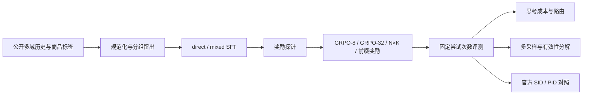

# 项目故事：MiniOneReason

**从“推荐前多想一会儿”到“训练信号从哪里来，收益又落在哪里”。**

这份故事按问题和实验之间的因果关系展开。先理解为什么做下一组对照，再到[项目深挖](项目深挖-MiniOneReason.md)练习口述与追问。数字统一见[实验结果与来源](实验结果与来源.md)，依据包括 2026-10-24 完成的 M1/M2/M3 补充评测。末尾的第一人称稿用于面试练习，个人负责范围按实际参与填写。

## 0. 先看这六段代码

| 入口 | 看懂的问题 | 故事位置 |
| --- | --- | --- |
| [data.py::input_view / split_for](../data.py#L83) | 哪些信息可以进入输入，同一段历史怎样分组 | [二](#story-02) |
| [train.py::training_records](../train.py#L12) | direct 和 mixed 究竟监督什么 | [三](#story-03) |
| [evaluate.py::metrics](../evaluate.py#L10) | 无效和重复答案为什么仍消耗尝试次数 | [四](#story-04) |
| [train.py::reward / branch_advantages](../train.py#L143) | 怎样制造奖励差异，怎样分给共享推理与答案 | [五](#story-05)、[六](#story-06) |
| [evaluate.py::thinking_experiments](../evaluate.py#L226) | 8 次探测后怎样分流，账单怎样计算 | [八](#story-08) |
| [ops/checks.py::decompose](../ops/checks.py#L199) | 命中增加来自有效输出，还是有效答案中的选择 | [十](#story-10) |



<a id="story-01"></a>
## 一、一个用户有上百条行为，推荐模型应该怎样作答

一次输入里有用户看过的视频、点击过的广告、浏览过的商品等多域行为。任务要求根据这些历史，生成一个接下来可能点击的商品。输出长这样：

```text
<|prod_begin|><s_a_12><s_b_34><s_c_56>
```

这是示意编码。`prod_begin` 表示商品领域，后面三个 token 是三级 SID；每级取值范围是 0–8191。模型沿用官方已有的 SID token 和预训练权重，本项目负责把推荐数据、后训练和评测接起来。

这类生成式推荐有一个很直接的吸引力：同一个语言模型可以阅读多域历史，也可以先写出兴趣分析，再生成商品编码。于是项目的起始问题是：**小模型多生成一段推理，能否换来更好的商品命中？如果能，应该给谁分配多少推理预算？**

要回答它，至少要把三件事连起来。训练时，模型是否学到了两种作答模式；评测时，每个模型是否花了相同次数的尝试；解释结果时，收益来自更有效的商品编码，还是更准确的选择。只把一次生成跑通，回答不了这些问题。

因此项目选择 OneReason-0.8B 作为基座，在公开商品推荐子集上做 LoRA SFT 与 RL。0.8B 的规模让单卡实验可执行，也让“每一步训练信号到底有没有用”变成值得仔细检查的问题。

**面试切入句**：项目研究的是生成式推荐中的训练信号和推理成本。输入是多域行为历史，输出是商品 SID，核心比较是直接回答、先思考，以及对两种模式做后训练之后的效果。

<a id="story-02"></a>
## 二、先把数据弄明白：计划里的五万条，实际只有两千多条训练样本

配置里主训练集的规模上限是 50,000。打开公开数据后，实际情况更具体：102 个分片共 48,269 条记录，最终答案属于商品领域的只有 3,988 条。目录名含有 Video，也不能据此判断每条记录的推荐领域，必须解析 assistant 的最终答案。

数据还有两层嵌套：`messages` 可能是 JSON 字符串，消息内容又是文本块列表。程序先还原 system、user、assistant 三轮结构，再从 `</think>` 之后解析商品标签。历史、标签、推理文本和来源记录分别保存。

接下来要处理一个容易忽略的问题：**相同历史出现两遍，如果一遍进训练、一遍进测试，模型就可能遇到几乎一样的输入。** 项目去掉任务请求、规范化空白，对历史文本计算 `group_id`，再按组进行哈希划分。

**代码 1｜输入只拿四个字段，划分只看历史组（节选）**

```python
def input_view(row):
    return {k: row[k] for k in
            ('sample_id', 'group_id', 'history', 'context_text')}

def split_for(group_id, seed=42):
    bucket = int(digest(group_id + str(seed)), 16) % 100
    return ('train' if bucket < 80 else
            'validation' if bucket < 90 else 'test')
```

**这段在做什么**：把数据记录变成输入专用视图，并让同一历史组获得同一个划分结果。

**为什么这样写**：原始记录里有目标 SID、教师推理和目标元数据。显式列出可读字段，能让历史选择和 prompt 构造自然地只依赖输入；按组划分则处理重复历史跨集合的问题。

**改了会怎样**：把完整记录传给裁剪函数，后续改动就可能按目标挑历史；按单条记录随机划分，相同历史可能落入不同集合。测试里通过修改目标、比较输入保持一致来验证这条边界。

训练数据还要经过目录检查和推理引用检查。如果 CoT 引用了被裁剪掉的历史，继续监督这段推理会让输入与答案失配；如果监督答案超过 1,024 token，直接截断可能把最终 SID 一起切掉。因此这些记录按原因过滤。

最终保留 train **2,647**、validation **385**、test **403** 条。这个变化决定了后续的实验判断：目录有约 1,030 万个 SID，监督数据却很稀疏，精确命中型 RL 很可能遇到大量零奖励组。

**接着练**：[深挖 03–07](项目深挖-MiniOneReason.md#q03)。**依据**：[数据报告](../reports/data_report_main.json)、[目录审计](../reports/catalog_report.json)。

<a id="story-03"></a>
## 三、先做直接回答与混合 SFT，把“多想一段”的作用单独摆出来

第一组对照很简单：direct 只学习输出商品 SID；mixed 同时学习直接回答和“推理＋SID”。两边使用相同的基础样本，每条都展开两次：direct 两次直接答案，mixed 一次直接答案、一次推理答案。

这样配对，先控制了样本来源和训练记录数。mixed 的推理更长，所以处理 token 仍更多；后面另做 token 匹配对照。把这些因素拆开，才能知道哪一组实验在回答哪一个问题。

**代码 2｜同一样本的两种监督（教学简化）**

```python
for thinking in (False, variant == 'mixed'):
    prompt = prompt_text(view, tok, chosen, thinking)
    completion = (
        reasoning + '\n</think>\n\n' if thinking else ''
    ) + target_sid + tok.eos_token

    p = tok.encode(prompt, add_special_tokens=False)
    a = tok.encode(completion, add_special_tokens=False)
    record = {
        'input_ids': p + a,
        'labels': [-100] * len(p) + a,
    }
```

**这段在做什么**：用聊天模板控制思考模式，只让 assistant 的目标内容参与监督。

**为什么这样写**：用户历史是条件，目标是学会在这些条件下生成答案。mixed 的推理 token 和最终 SID 都受监督；direct 只监督最终 SID 与结束符。padding 也用 `-100` 屏蔽。

**改了会怎样**：如果连输入一起监督，大量历史 token 会改变训练目标和权重分配；如果两边来自不同数据子集，观察到的差值就混入了样本差异。

训练使用 rank 16 的 LoRA，约 1,009 万个可训练参数，BF16、micro batch 1、梯度累积 16。常规 direct、mixed 与历史 SFT 变体用同一组固定验证样本的 non-thinking Recall@32 选择检查点，同分保留更早的权重。token 匹配对照使用达到预算后的终点权重，以保持训练量约束。

测试结果没有顺着“会写推理就更会推荐”的直觉走：

| 模式 | Recall@32 | 命中 / 403 |
| --- | ---: | ---: |
| direct SFT | 2.730% | 11 |
| mixed SFT，non-thinking | 1.985% | 8 |
| mixed SFT，thinking | 2.233% | 9 |

这组结果给了下一步很清晰的方向：**推理能力需要用最终推荐收益检验，训练出更长的解释并不会自动完成这件事。** 后续的 RL 于是从同一 mixed 检查点出发，用任务奖励改变输出分布。

**接着练**：[深挖 08–11](项目深挖-MiniOneReason.md#q08)。**依据**：[SFT 结果](../reports/PROJECT_REPORT.md)、[训练实现](../train.py#L29)。

<a id="story-04"></a>
## 四、先把尺子固定：一百次机会当然更容易撞中

生成式推荐的一次输出可能落到目录外，也可能与前一次重复。如果每个模型都补采样到 32 个不同合法商品，合法率差的模型就会悄悄获得更多调用机会，成本和效果都失去同一个比较基础。

项目主评测固定每个输入生成 64 次，报告原始顺序前 8、32、64 次的结果。无效答案保留为失败尝试，重复答案也占次数；命中集合才做去重。

**代码 3｜先按原始顺序占位，再计算命中（节选）**

```python
items = []
for output in pred['outputs']:
    sid, reason = parse_answer(output['text'], catalog)
    items.append(sid)  # 无效时为 None，保留这次机会的位置

target = set(row['targets'])
for k in ks:
    hit = len(set(items[:k]) & target)
    recall = hit / len(target)
    passed = float(hit > 0)
```

**这段在做什么**：把“允许生成多少次”落实为可计数的预算。本地只有一个目标，Recall 和 Pass 都是这组尝试有没有命中。

**为什么这样写**：推荐的是目录中的真实候选，语法正确还要检查目录成员资格；只在思考段里提到目标，也不能当成最终推荐。

**改了会怎样**：提前移除无效答案再取前 K，会改变尝试预算；把采样顺序当排名顺序算 NDCG，会给这套实验附加一个没有设计过的排序含义。

同一项目还记录生成 token、无效原因、重复率和目录覆盖。**固定尝试数控制机会，生成 token 描述代价。** 64 个直接答案与 64 段长推理，次数相同，计算量可以差很多。

**接着练**：[深挖 12–14](项目深挖-MiniOneReason.md#q12)。**依据**：[评分代码](../evaluate.py#L10)。

<a id="story-05"></a>
## 五、标准 RL 的第一个问题：大多数题没有可比较的好坏

GRPO 对同一个输入生成多条输出，根据组内奖励的相对高低更新策略。精确命中奖励在这里是 0 或 1：目录内 SID 与目标完全一致才得 1。

如果八条答案全错，减去组均值后，任务优势全部是零。训练虽然能执行反向传播，但这道题没有提供“哪个答案更好”的命中奖励信号。

项目先在最多 256 个真实训练提示上做奖励探针，并把“至少 1% 的组有奖励差异”作为训练门槛。结果如下：

| 探针 | 有奖励差异的组 |
| --- | ---: |
| 标准 GRPO，8 条完整轨迹 | 3.12% |
| 标准 GRPO，32 条完整轨迹 | 5.47% |
| N×K，4 段推理各接 8 个答案 | 5.47% |
| 同一 N×K 输出加 SID 前缀奖励 | 22.66% |

增加采样数有帮助，但“多生成完整推理”的成本很高。另一条思路是让一段推理服务多个答案：先生成四段推理，每段接八个答案，仍然得到 32 个终局答案。这就是本项目的 N×K 分支结构。

第三条思路来自 SID 的分级编码。全码命中难，前两级或第一级匹配可以作为更细的训练反馈，但必须先通过完整 SID 的目录合法性检查。

```python
def reward(text, targets, catalog, prefix=False):
    sid, _ = parse_answer(text, catalog)
    if sid is None:
        return 0.0
    if sid in targets:
        return 1.0
    if not prefix:
        return 0.0
    a = codes(sid)
    return max(
        0.5 if a[:2] == codes(t)[:2] else
        0.2 if a[0] == codes(t)[0] else 0.0
        for t in targets
    )
```

**这段在做什么**：给合法候选增加分级反馈。不存在于目录的“相似前缀编码”仍是零分。

**为什么这样写**：反馈层级越细，组内越容易出现差异；先做目录检查，可以把学习信号约束在可推荐的商品编码上。

**改了会怎样**：跳过目录检查，模型可能学会拼出不存在的高奖励 SID；只看前缀奖励上涨，则无法知道最终完整商品命中是否改善。项目继续记录精确命中、前缀命中、一级码熵与热门码占比。

这里的 22.66% 是**训练信号覆盖率**。它说明更多题可以形成组内比较，后面的独立评测才回答推荐是否变准。

**接着练**：[深挖 15–18](项目深挖-MiniOneReason.md#q15)。**依据**：[奖励探针](../reports/rl/main_probe_summary_42.json)。

<a id="story-06"></a>
## 六、共享了推理以后，奖励应该怎样分回去

N×K 的难点不只在生成。假设一段推理接出的八个答案中有一个命中，另一段推理的八个答案全错，前一段推理应该得到更高信用；每个答案又要保留自己的好坏差异。

实现先在同一个提示的全部 32 个奖励上标准化，得到每个答案的优势；一段共享推理的优势，取其八个答案优势的均值。

**代码 4｜答案各拿自己的优势，推理拿子答案的均值（节选）**

```python
def branch_advantages(rewards):
    r = np.asarray(rewards, dtype=float)  # N × K，只含一个提示
    a = (r - r.mean()) / (r.std() + 1e-4)
    return a.mean(axis=1).tolist(), a.tolist()

shared, individual = branch_advantages(rewards)
for i, branch in enumerate(branches):
    add_segment(prompt, branch['prefix']['text'], shared[i])
    for j, answer in enumerate(branch['answers']):
        add_segment(branch['branch_prompt'], answer, individual[i][j])
```

后半段是 `branch_segments()` 的教学写法，`add_segment` 表示加入训练片段；生产实现保存实际 token 解码后的答案文本。

**这段在做什么**：让每段共享推理只出现一次，让每个答案分别接受终局反馈。

**为什么这样写**：把完整轨迹直接复制八遍，会在当前这种“共享推理只计一次、按生成 token 归一化”的目标中放大推理片段的权重。共享推理的价值由它能导向怎样的一组答案来衡量。

**改了会怎样**：每个分支各自标准化，会丢掉分支之间的整体好坏；把多个提示混在一起标准化，则混入题目难度差异。测试用两个提示分别手算，核对分组和信用分配。

训练还遇到一个更隐蔽的参照系问题。LoRA 模型关闭适配器后回到预训练模型，而 RL 想约束的是“不要离起始 mixed-SFT 策略太远”。项目为标准 GRPO 显式加载冻结的 SFT 参考模型；N×K 则加载 `reference` 适配器，并逐张量核对其初始权重与策略相同。

这一步让 KL 正则有了明确对象。否则日志里的 KL 再平稳，也可能是在约束另一个距离。

**接着练**：[深挖 19–23](项目深挖-MiniOneReason.md#q19)。**依据**：[分支更新](../train.py#L393)、[参考适配器](../train.py#L426)、[单元测试](../tests/test_pipeline.py)。

<a id="story-07"></a>
## 七、把“多采样”和“前缀反馈”拆开看，收益才有解释

正式训练保留四组：GRPO-8、GRPO-32、N×K、N×K＋前缀奖励。它们从同一 mixed-SFT 出发，按相同的 500 个训练输入顺序更新。GRPO-32 提供与 N×K 相同终局答案数的参考；无前缀 N×K 则帮助观察分支采样本身的效果。

thinking 模式测试结果是 2.481%、2.730%、2.730%、4.467%。起始 mixed thinking 为 2.233%。这条结果链把注意力引向了前缀反馈：32 个完整答案和 4×8 分支都得到 11/403，加入前缀反馈后是 18/403。

主比较中，RL prefix 相对 mixed thinking 提高 **2.233 个百分点**，分组配对 bootstrap 的 95% 区间为 **[0.478, 4.082]**。比较对象换成 direct SFT，则提高 1.737 个百分点，区间跨零。

这组实验最适合讲的判断是：**在这套稀疏监督任务里，让错误答案之间出现有意义的奖励差异，比单纯扩大终局采样数更值得继续研究。** 同时，标准 GRPO 和 N×K 的生成后端、共享推理权重及损失归一化存在差异，因此具体机制继续通过探针、消融和补充评测展开。

**接着练**：[深挖 24](项目深挖-MiniOneReason.md#q24)、[35](项目深挖-MiniOneReason.md#q35)。**依据**：[主结果](实验结果与来源.md#3-主模型对照)。

<a id="story-08"></a>
## 八、模型变好以后，再问多想这一段值不值

主模型对照里的 `budget=None` 让模型在给定总生成长度内自然作答。成本实验另外控制思考段上限：0、128、256、512、1024 token；到边界后接上正确的 `</think>`，再生成最终商品答案。

每个输入固定 32 次最终尝试。RL prefix 的部分结果是：

| 思考预算 | Recall@32 | 生成 token / 输入 |
| ---: | ---: | ---: |
| 0 | 2.978% | 160.0 |
| 128 | 3.474% | 4,256.3 |
| 512 | 3.722% | 16,523.2 |
| 1024 | 3.722% | 24,635.3 |

从 512 加到 1024，本次测试的召回没有变化，token 明显增加。这给出一个实用取舍：在这两档已运行设置里，512 使用约少 32.93% 的生成 token 达到相同召回。

接着尝试自适应思考。先给每个输入生成 8 个直接答案，从一级 SID 的分散程度或历史长度得到路由信号；验证集选择正预算中的最佳档位并冻结阈值，测试只应用这些选择。

**代码 5｜路由后的答案集合与成本（教学简化）**

```python
if use_thinking:
    final_answers = thinking_32
    overhead_tokens = sum(x['generated_tokens'] for x in probe_8)
else:
    final_answers = probe_8 + direct_24
    overhead_tokens = 0  # probe 已在 final_answers 中计算

cost = overhead_tokens + sum(
    x['generated_tokens'] for x in final_answers
)
```

**这段在做什么**：每个输入仍用 32 次最终答案评分，同时计入为路由付出的探测成本。

**为什么这样写**：进入思考分支时，8 个直接探测答案被放弃，但它们已经真实生成。全非思考、路由和同等人数随机路由共享保存下来的调用结果，便于配对比较。

**改了会怎样**：探测答案和思考答案一起评分，实际就给了 40 次机会；丢掉探测账单，又会把路由显得过于便宜。

结果揭示了另一个重要取舍：RL 路由相对随机分配思考可能更好，但都没有超过同源 8＋24 次全非思考对照的 **4.963%**。因此“能识别比随机更值得思考的输入”和“整个方案比直接回答更划算”，需要分别验证。

**接着练**：[深挖 25–28](项目深挖-MiniOneReason.md#q25)。**依据**：[RL 成本与路由](../reports/main_rl_nk_prefix_thinking_42_test_summary.json)。

<a id="story-09"></a>
## 九、数据和训练量都可能解释差异，于是补两组控制

第一组控制处理训练 token。mixed 学习更长的推理，即使训练记录数相同，也会看到更多 token。`direct_tokenmatched` 读取 selected mixed 检查点的实际处理量作为预算，让 direct 一直训练到完整优化步骤越过这条预算线。

目标为 3,958,467 token，实际 3,970,388，超出 0.301%。学习率 warmup 和衰减跟随 token 进度，避免为了凑 token 增加 epoch 上限以后，训练结束时学习率仍处在另一阶段。这让 token 匹配成为训练程序中的实际停止条件。

预算匹配后的 direct 在测试集命中 13/403 条，Recall@32 为 **3.226%**；相对 mixed 非思考的 1.985%，差值 **+1.241 pp [−0.267, 2.949]**。在这组训练量控制下，mixed 也没有表现出更高的直接推荐召回。

第二组控制处理历史。直觉上，近期行为、商品行为、不同兴趣各留一点可能更全面；但如果输入全部装得下，三种策略得到的内容就完全一样。长度统计显示，2,048 token 下测试输入没有被裁剪；1,024 token 下约 34.24% 需要裁剪。项目因此在 1,024 做真正有选择压力的实验。

为区分训练时与评测时的历史分布，另训 recent 和 balanced 两个适配器，使用两种策略都能保留 CoT 引用的公共训练子集，再做 2×2 评测。两组训练模型都是 recent 1.489%、balanced 1.985%，区间跨零。

这两组控制让项目更容易解释：token 匹配处理训练投入，历史交叉对照处理输入策略；它们各自对应一个明确的替代解释。

**接着练**：[深挖 10](项目深挖-MiniOneReason.md#q10)、[29–30](项目深挖-MiniOneReason.md#q29)。**依据**：[token 训练记录](../reports/training/main_direct_tokenmatched_42_complete.json)、[匹配后测试结果](../reports/results_v2/direct_tokenmatched_42_test_recent_in2048_thinkFalse_budgetNone_n64_vllm.json)、[配对差值](../reports/PROJECT_REPORT.md)、[历史门槛](../reports/history_gate_main.json)。

<a id="story-10"></a>
## 十、召回提高以后，继续弄清收益落在什么地方

403 条测试输入中，多命中一条就约增加 0.248 个百分点。主结果的正向差值值得跟进，也需要检查是否依赖某次随机采样，以及是否主要由目录外答案减少带来。

补充评测先固定 mixed 与 RL prefix 两组权重，给 non-thinking 各做五个采样 offset。五次配对差值全部为正，平均 Recall@32 从 **1.836% 到 3.474%**，合并差 **+1.638 pp [0.500, 3.027]**。这里重跑的是生成，训练权重没有变化。

然后把无效输出拆开。两组非思考模型的平均有效率从 **61.163% 提高到 70.125%**，最主要的无效原因是目录外 SID。合法答案增加，固定次数下可用的推荐机会自然增加。

要进一步观察推荐选择，程序从每条已保存的 64 次生成中按顺序抽出合法答案，在双方都有至少 16 个合法答案的共同样本上比较。跨五次 non-thinking 采样，共同合格 393 条，等有效预算 Recall@16 差值为 **+0.560 pp [−0.458, 1.578]**。

thinking 的 offset 0 则在 396 条共同合格样本上，保留 **+1.768 pp [0.253, 3.535]** 的等有效预算差值。两种模式因此呈现不同的诊断结果：非思考最清楚的变化是目录有效性，思考在合法候选之间也保留了更好的命中表现。

这一步把“RL 有提升”推进成了更具体的问题：**它让模型更少浪费机会，还是让有效机会本身更容易选中目标？** 分解是在合格子集上的条件分析，后续若要估计因果贡献，可加入同协议的目录约束解码对照。

**接着练**：[深挖 31–33](项目深挖-MiniOneReason.md#q31)。**依据**：[补充评测](../reports/checks/CHECKS_REPORT.md)。

<a id="story-11"></a>
## 十一、走到官方任务，SID 命中与真实商品命中开始分开

本地任务评价一个目标 SID；真实商品有 PID，而同一个 SID 可能对应多个 PID。目录审计发现约 208 万个 SID 存在这样的碰撞。因此，本地 SID 命中之后，还要检查映射回商品时发生了什么。

项目在官方 v3.1-public 商品任务的完整 1,000 条样本上运行评测，保留官方 prompt、Race 思考 32＋直接 32 候选、beam search 和 SID/PID 评分。随后补上 mixed-SFT 基线，让 RL 模型有同协议对照。

| 指标 | mixed SFT | RL prefix |
| --- | ---: | ---: |
| SID Recall@64 | 7.188% | 7.488% |
| PID Recall@64 | 1.816% | 2.002% |
| PID Pass@64 | 2.800% | 3.100% |

PID Recall@64 的差值为 **+0.186 pp [−0.275, 0.672]**。方向与本地主结果一致，外部任务的区间跨零。官方 SID 有效率还从 17.373% 降到 16.297%，说明输入、解码和候选协议改变后，本地诊断需要重新检查。

另一项独立检查关注推理内容。阅读六个验证案例时，可以看到输入没有提供的日期、搜索行为和历史引用；其中也有最终推荐命中的例子。最终标签和叙述依据因此需要两种评价方法：前者用任务指标，后者要核对输入事实。

**接着练**：[深挖 34–38](项目深挖-MiniOneReason.md#q34)。**依据**：[官方对照](../reports/checks/official_baselines.json)、[案例检查](../reports/case_review.md)。

<a id="story-12"></a>
## 十二、实验能恢复，结论才有可以回头核对的来源

长实验被中断时，关键是保住已生成的预测、训练状态和它们各自的身份。这个项目把模型权重和完整预测放在数据目录，小型汇总放在仓库；预测设置记录适配器哈希、样本 ID、prompt 哈希、采样参数、后端和运行标识。

恢复时先比较设置，再跳过已完成样本。相同输入的缓存复用还要检查模型、seed、预算、尝试数和实际 prompt 都一致。每次 RL rollout 重新加载当前 LoRA，更新时通过 vLLM sleep/wake 腾出显存。两种后端的 v2 贪心检查有 29/32 条 token 序列一致，正式模型比较因此统一使用 vLLM。

主队列用进程锁避免重复启动，子任务非零退出就停下；训练保存优化器与随机状态，官方评测按完整批次保存结果。恢复记录的作用，是让“这个数字来自哪个模型、哪组调用”一直可回答。

故事最终形成了三条可以展开的经历：**把开放数据变成可评测任务，给稀疏推荐提供可学习的分级反馈，用分层对照判断收益与成本。**

**接着练**：[深挖 39–40](项目深挖-MiniOneReason.md#q39)。**依据**：[缓存身份](../evaluate.py#L70)、[后端检查](../reports/backend_parity_v2.json)、[流水线](../run.py#L81)。

## 十三、面试时讲成一条研究经历

### 30 秒版

> MiniOneReason 是基于 OneReason-0.8B 的生成式推荐后训练项目。输入多域行为历史，输出商品 SID。我围绕稀疏奖励实现了 4×8 分支采样和分级 SID 奖励，并用固定尝试次数、token 成本和官方商品任务评测。固定训练权重的五次非思考采样中，平均 Recall@32 从 1.836% 到 3.474%；进一步分解发现，目录有效性改善是一个关键变化。

### 2 分钟版

> 我做这个项目，是想弄清小模型在推荐前多想一段，到底能换来多少收益。基座用官方 OneReason-0.8B，输入是用户的多域历史，输出是三级商品 SID。
>
> 第一步把公开数据整理成 2,647 条训练、385 条验证和 403 条测试，按相同历史分组。然后做直接回答和混合推理 SFT，发现混合模型思考时的 Recall@32 是 2.233%，没有超过直接 SFT 的 2.730%。所以后续重点转到任务奖励。
>
> 精确命中奖励很稀疏：标准八条采样里，只有 3.12% 的提示组有奖励差异。我实现了四段推理、每段八个答案的 N×K 采样，给完整命中、前两级命中、一级命中分别打 1、0.5、0.2 分。前缀奖励把探针里的有效奖励组提高到 22.66%。共享推理拿八个答案优势的均值，每个答案保留自己的优势。
>
> 测试时，RL 前缀模型 thinking Recall@32 达到 4.467%，相对 mixed thinking 提高 2.233 个百分点。补充评测固定权重做五次非思考采样，平均从 1.836% 到 3.474%，五次差值都为正。再做相同有效答案数的分析，看到非思考模式最清楚的收益是减少目录外 SID。
>
> 成本上，我把推理预算和八次路由探测都计入 token。路由没有超过同源的全非思考对照，因此我保留了这个结果。官方一千条商品任务里，PID Recall@64 从 1.816% 到 2.002%，区间跨零。整个项目让我把训练信号、最终命中和成本放到同一套证据里判断。

### 5 分钟展开顺序

| 时间 | 讲什么 | 可展开的技术点 |
| --- | --- | --- |
| 0:00–0:40 | 任务与动机 | 多域历史、商品 SID、思考成本 |
| 0:40–1:20 | 数据与 SFT | 分组划分、标签隔离、两种监督、token 控制 |
| 1:20–2:35 | RL 的核心判断 | 全零组、4×8、前缀奖励、共享信用、冻结 SFT 参考 |
| 2:35–3:30 | 主结果与补充验证 | +2.233 pp、五次采样、合法率与等有效预算 |
| 3:30–4:15 | 成本与输入 | 五档预算、路由探测账单、1,024 历史对照 |
| 4:15–5:00 | 外部结果与下一步 | SID/PID、官方基线、约束解码或多训练种子实验 |

### 十个高频追问

1. SID 是怎样表示商品的，为什么会碰撞？见[深挖 02](项目深挖-MiniOneReason.md#q02)、[34](项目深挖-MiniOneReason.md#q34)。
2. 配置五万条，为什么最后训练只有 2,647 条？见[03](项目深挖-MiniOneReason.md#q03)。
3. mixed 为什么每条数据展开两次，公平性控制了哪些量？见[08](项目深挖-MiniOneReason.md#q08)、[10](项目深挖-MiniOneReason.md#q10)。
4. 全零组为什么没有任务优势，KL 还会不会更新？见[15](项目深挖-MiniOneReason.md#q15)、[23](项目深挖-MiniOneReason.md#q23)。
5. 4×8 和直接采样 32 条有什么区别？见[17](项目深挖-MiniOneReason.md#q17)。
6. 共享推理为什么取子答案优势均值？见[19](项目深挖-MiniOneReason.md#q19)。
7. 五次采样意味着做了五次独立训练吗？见[31](项目深挖-MiniOneReason.md#q31)。
8. 4.467% 相比哪个基线，实际多命中多少条？见[35](项目深挖-MiniOneReason.md#q35)。
9. 路由比随机好，为什么还不能作为默认方案？见[28](项目深挖-MiniOneReason.md#q28)。
10. 如果再给一周算力，先做哪项实验，什么结果会改变你的判断？见[40](项目深挖-MiniOneReason.md#q40)。
